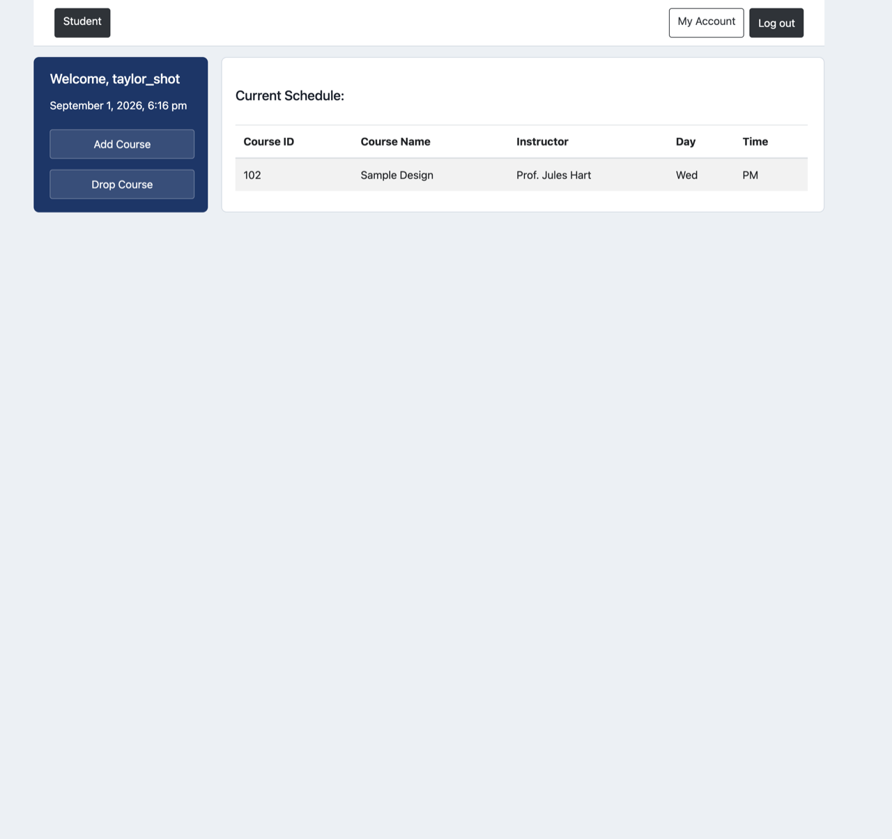
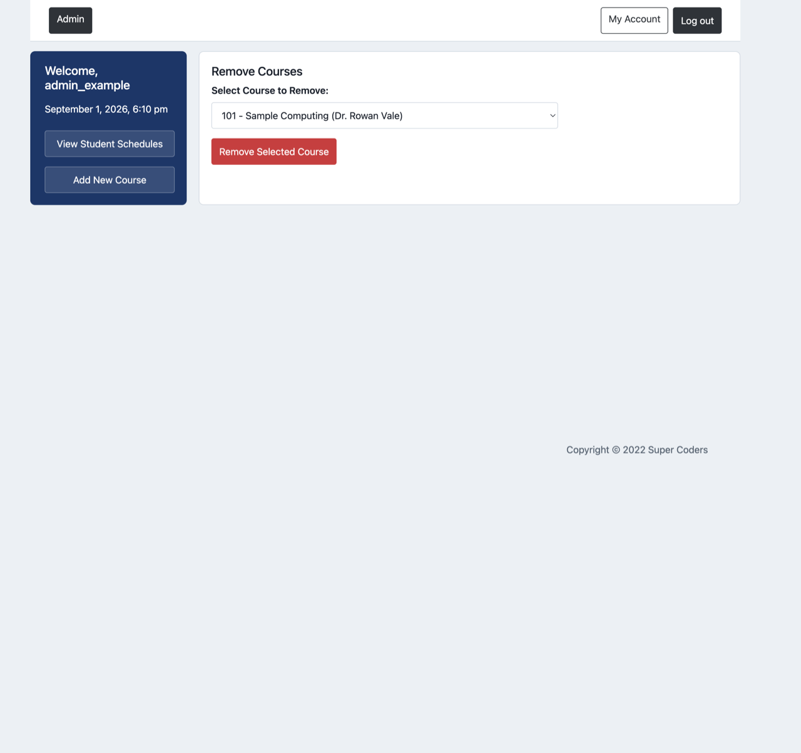
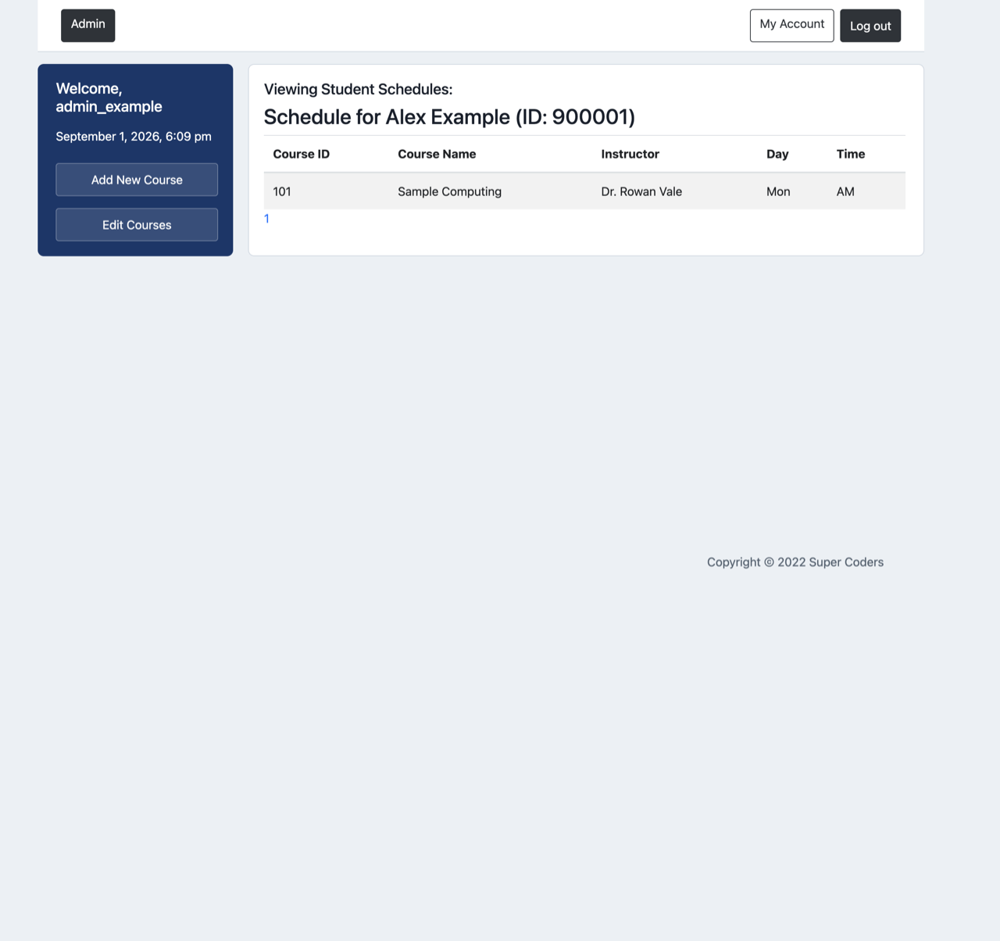

# Course Registration Database System

This was built as a group project for an Internet Computing class. The PHP interface demonstrates how students and administrators interact with a small relational database for accounts, courses, and enrollment records.

## Database design

The schema is in [`database/schema.sql`](database/schema.sql). It contains four tables:

| Table | Purpose |
| --- | --- |
| `admins` | Administrator identity, unique username, and password field |
| `students` | Student identity, unique username, and password field |
| `courses` | Course catalog entries with instructor, day, and time |
| `enrolled` | Join table connecting students to courses |

`enrolled` models the many-to-many relationship between students and courses. Its composite primary key prevents duplicate enrollment, while foreign keys prevent enrollment rows from referring to missing students or courses. Username constraints prevent duplicate login names.

The checked-in rows are fictional fixtures only. Password columns contain obvious, unusable dummy values rather than real credentials. Locally created student accounts use PHP's `password_hash`, and login checks use `password_verify`.

## Database operations

The application uses PHP PDO for MySQL access. Database work includes:

- prepared statements for user-supplied values;
- student and administrator authentication queries;
- course creation, editing, and deletion;
- enrollment insertion and deletion;
- joins for student schedule views; and
- a schedule-conflict query that compares course day and time.

Connection settings are read from environment variables in [`config.php`](config.php). No database credentials are stored in tracked source files.

## Run locally

Requirements:

- PHP with the PDO MySQL extension
- MySQL or MariaDB
- a web server such as PHP's development server or Apache in XAMPP
- Docker for the disposable integration test

1. Create a local environment file from the placeholder template:

   ```sh
   cp .env.example .env
   ```

2. Replace every placeholder in `.env` with local-only database settings. The file is ignored by Git.

3. Import the schema and fictional fixtures:

   ```sh
   mysql -u your_local_user -p < database/schema.sql
   ```

4. Export the settings and start the PHP development server:

   ```sh
   set -a
   source .env
   set +a
   php -S 127.0.0.1:8000
   ```

5. Open `http://127.0.0.1:8000`.

The fixture password values intentionally cannot be used to sign in. Create a local student account through the application or replace fixture values with locally generated password hashes.

## Application flows

Students can create an account, sign in, view a schedule, and add or drop courses. Administrators can sign in, manage course offerings, and view student schedules.

Student schedule after enrollment:



Administrator course catalog:



Administrator view of student schedules:



## Security model

Authentication creates an explicit `student` or `admin` session role. Every protected route checks that role before loading application data, so a student session cannot reach administrator pages or mutations. Login rotates the session identifier. Every state-changing form, including logout, requires a session-bound CSRF token.

Database error details are not returned to the browser. The public home and login pages do not open a database connection.

## Verification

Run the repository checks with:

```sh
./scripts/verify.sh
```

The script syntax-checks every PHP file, runs the focused security checks, and starts a disposable MySQL container for real HTTP workflow tests. Those tests cover account creation, student and administrator login, role separation, course management, enrollment changes, rejected CSRF requests, and logout. The test removes its container and database when it finishes. GitHub Actions runs the same command on pushes and pull requests.

To run only syntax and focused security checks when Docker is unavailable:

```sh
SKIP_INTEGRATION=1 ./scripts/verify.sh
```

## Authorship

This was a 2022 Internet Computing class group project credited on-screen as Super Coders. The original course report (removed from public history during the security cleanup) described these work areas:

- administrator course management
- schedule viewing
- logout
- wireframes and CSS

Individual contributor names are not in the current Git tree. Only later maintenance commits by this repository's owner are on `main`. Names should be added here once the original group confirms them.

## License status

The repository does not grant an open-source license. Licensing should wait until the original contributors agree.

## Technology

- PHP and PDO
- MySQL or MariaDB
- HTML and CSS
